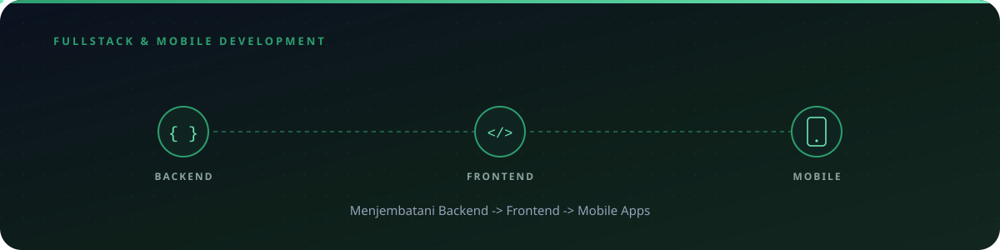
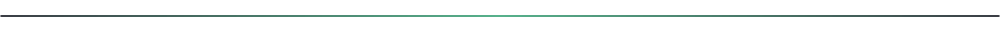

 

## 👋 Tentang Saya

Saya mahasiswa <b>Universitas Esa Unggul</b> dengan minat mendalam di bidang <b>Software Engineering</b>, dan saat ini aktif berkarya sebagai <b>Fullstack & Mobile Developer</b>. Saya terbiasa menjembatani logika backend, antarmuka frontend, hingga pengembangan aplikasi Android dalam satu alur kerja yang utuh. Saya senang memecahkan masalah kompleks dan selalu berusaha menulis <i>clean code</i> yang rapi, terstruktur, dan siap dikembangkan lebih jauh.

 

## 🎯 Sedang Didalami

- 🧩 Struktur Data & Algoritma (DSA)
- 🌐 Web Fundamentals
- 🗄️ SQL & Database
- 🔧 Git & Version Control
- 🖧 Dasar-dasar OS & Networking

 

## 🛠️ Tech Stack

**Frontend**

**Backend**

**Mobile** — Kotlin, Android Studio (MVVM, Room, Hilt, Retrofit)

**Tools & Lainnya**

 

## 🚀 Highlight Proyek

| Proyek | Deskripsi | Status |
|---|---|---|
| 🌐 **[StudyMatch](https://github.com/mgeraldiarr/StudyMatch)** | Platform belajar berbasis web interaktif | ✅ Aktif |
| 💼 **[Web Portfolio](https://portofolio-nu-sage.vercel.app/)** | Website portofolio pribadi | ✅ Aktif |
| 📱 **Aplikasi Android Native** | Dibangun menggunakan Kotlin | 🚧 Dikerjakan |
| ⚙️ **Fullstack Web App** | Dibangun menggunakan React & Node.js | 🚧 Dikerjakan |

 

## 📊 GitHub Stats

 

## 📫 Mari Terhubung

 

Thanks for stopping by 👋

